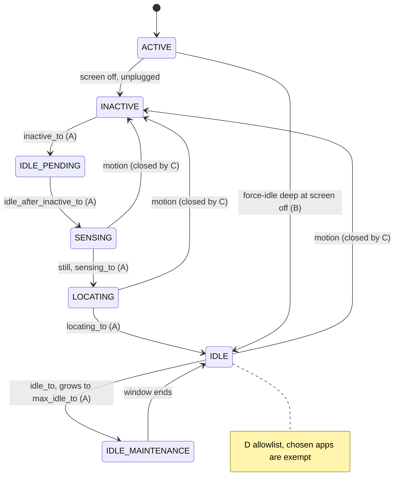
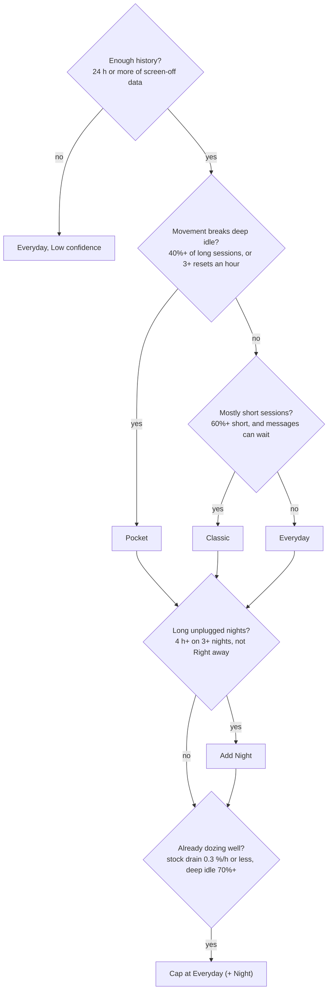

# EnforceDoze A17 Fork — Master Build Spec

Nov 7, 2026 · @Tuğberk Özgen

## 0. How to use this spec

This spec turns the EnforceDoze fork ([Akylas/EnforceDoze](https://github.com/Akylas/EnforceDoze), GPL-3.0) into a Doze controller that works on Android 17 with One UI 9 (ADR 0022), proves it works with its own logs, ships tuned profiles and recommends one from the owner's own usage. The building agent reads the whole spec, then starts Phase 0 without asking.

### 0.1 Files created in Phase 0

| File | Content |
| --- | --- |
| `SPEC.md` | This document. The agent changes it only through an ADR. |
| `CLAUDE.md` + `AGENTS.md` | Rules (0.3), environment (0.4), autonomy (0.5), section index. Max 150 lines. |
| `PRODUCT.md`, `DESIGN.md` | From `/impeccable init`, aligned with sections 1 and 10. |
| `docs/adr/`, `docs/progress.md`, `docs/questions.md` | Decisions, phase summaries, non-blocking questions with the default in use. |
| `docs/upstream-audit.md` | The feature-by-feature audit of section 2, kept current as features are ported. |
| `fixtures/<device>/<build>/` | Raw `dumpsys deviceidle`, `dumpsys sensorservice`, `logcat -b events`, `dumpsys batterystats --history` captures for parser tests. |

### 0.2 Priority when rules conflict

1. Device safety: calls, alarms set by the user and emergency features always work; nothing leaves the phone in a state the user cannot undo.
2. Honesty: the app never claims Doze worked unless its logs show it.
3. No self-inflicted drain: the controller must not wake the phone it is trying to keep asleep.
4. Functional requirements in this spec.
5. `/impeccable` design rules (section 10).
6. Material 3 and Android guidance.
7. The agent's preferences.

### 0.3 Agent rules

1. Read `SPEC.md` completely, then begin P0. Asking a question this spec already answers is a violation.
2. Never invent a `dumpsys` / `cmd` flag, `device_config` key, EventLog tag, hidden API or binder transaction. Verify each against AOSP source for API 37 or probe it on the device, and cite it in a code comment (ADR 0022).
3. Resolve library versions at build time; never from memory.
4. Work in the phases of section 14; a phase ends when its gate passes.
5. Small Conventional Commits; every commit builds and passes unit tests.
6. Keep GPL-3.0, the upstream copyright notices and a visible credit to ForceDoze and EnforceDoze.

### 0.4 Environment

| Node | Role | Access |
| --- | --- | --- |
| `build-server` (VPS) | Agent, builds, JVM tests | Always |
| `akane-linux` (owner's PC, KVM, the project's own AVD `ed-api37`, ADR 0021) | Emulator tests (API 37 only) | Directly whenever `tailscale status` shows it online; one headless emulator at a time, shut down after |
| `sm-s938b` (owner's Galaxy S25 Ultra) | One UI 9 behaviour, real Doze nights | Ask first; batch work into planned sessions |

Reach `akane-linux` over SSH via Tailscale with ADB forwarded (`ssh -N -L 5037:localhost:5037 akane-linux`). The phone runs the owner's own Doze setup (Tasker profiles calling a shell script through Shizuku); never change Doze or sensor state on it without saying so first, and restore it afterwards.

### 0.5 Autonomy

The agent never waits for a "continue", at a gate or between phases, and never ends a turn with a question. It stops only for: connecting to the phone; anything irreversible or public (releases, force-push, deleting data); secrets it lacks. Any other question gets the most reasonable choice, an ADR and an entry in `docs/questions.md`, and work goes on; a change to a non-negotiable (1.3) is parked with a question, never made by the agent (ADR 0027). Hard- or costly-to-reverse decisions (architecture such as module boundaries, the engine's command model and the recommender model; a data format; a database schema; a public API; deleting or reverting something) get a second opinion from a fresh read-only subagent, options presented neutrally, both views recorded in an ADR; every other choice gets a one-line reason in an ADR. Work the spec marks optional waits in `BACKLOG.md` until the section 15 checklist is done, then the owner picks (ADR 0023). Stuck after 3 distinct attempts or about 45 minutes: a debugging subagent with evidence only, then mark blocked and move on. The engine (section 5) and the parsers (section 8) each get one independent subagent review before their phase gate. One short summary per phase gate, nothing else.

## 1. Goal, principles and success criteria

The app gets the phone into deep Doze sooner and keeps it there longer while the screen is off, and every morning it can show, from system records, exactly what happened: when deep sleep started, what interrupted it, which sensors were on and who woke the phone.

### 1.1 Principles

1. **Proof over promises.** Every profile is judged by measured deep-sleep time, not by its settings.
2. **System timers first.** Prefer tuning Doze's own constants over the app's own alarms; the controller must not become the wakeup it fights.
3. **Reversible always.** Every change records the previous value; one tap restores stock.
4. **Never break the essentials.** Calls, user alarms, navigation, Android Auto, music and hotspot are protected by hold-offs (5.5).
5. **Explain the recommendation.** "Recommended" always says why, with predicted and then measured numbers.
6. **One owner of Doze.** The app detects other Doze managers and never fights them silently.

### 1.2 Scope

- In: deep and light Doze control, sensor restriction during screen off, Doze allowlist, schedules, hold-offs, logs and reports, profiles, recommendation, Tasker and tile control.
- Kept from upstream behind the root tier: mobile data and Wi-Fi off in Doze, biometrics off in Doze, app suspension during Doze.
- Out: per-app battery attribution (that is Coulomb's job; section 11 connects the two), kernel or governor tuning.

### 1.3 Non-negotiables

- Works on Android 17 (API 37) on the Galaxy S25 Ultra with One UI 9 (ADR 0022).
- Never polls or schedules alarms while the screen is off, except the single optional delay alarm described in 5.3.
- Restores stock Doze constants, sensor mode and allowlist on uninstall-request, on disable and from a one-tap "Restore stock".
- No network permission.
- Phone calls, alarm clocks set by the user and emergency alerts are never blocked.

### 1.4 Success criteria

| Criterion | Target | Measured by |
| --- | --- | --- |
| Time from screen off to deep idle, recommended profile, phone still | Within 1 minute of the profile's target | Night report (8.6) |
| Deep-idle share of screen-off time on a night with the phone still | ≥ 90% | Night report |
| Wakeups caused by the app itself while the screen is off | 0 (1 if the delay alarm is enabled) | System alarm and wakelock records for its own uid |
| Report accuracy | Deep-idle minutes within 2% of `batterystats` for the same window | Parser cross-check (13.3) |
| Stock restore | `dumpsys deviceidle` constants and sensor mode identical to the pre-install capture | Restore test (13.4) |
| Design | All `/impeccable` gates pass | Gate log |

## 2. Starting point: the upstream fork

Upstream already does the right things, but through mechanisms that are fragile on Android 17: Shizuku is reached by reflection into a private method, and the all-sensors toggle uses raw binder transaction numbers. Both must be replaced before anything else.

### 2.1 What exists (checked in the repository on 2026-11-07)

| Item | State |
| --- | --- |
| Version | 1.10.2 (versionCode 86); last feature commit 2026-05-19 ("doze periods"), translations through 2026-07-26 |
| SDK | `compileSdk` 36, `targetSdk` 36, `minSdk` 23 |
| Code | 43 Java files, 2 Kotlin; `ForceDozeService.java` alone is 1,636 lines; about 8,100 lines in total |
| Build | Gradle 8.13, Java 17 |
| Privileges | Root via libsuperuser, or Shizuku api 13.1.5 |
| Doze control | `dumpsys deviceidle force-idle deep` / `unforce` with root or Shizuku; without them, Doze constants through `device_config put device_idle` on API 34+ and `settings put global device_idle_constants` below. On API 34+ that non-root path cannot work: SELinux denies the app process the `device_config` binary, nothing is applied, and the service still logs "Entering Doze" (ADR 0004) |
| Sensors | `dumpsys sensorservice restrict [package]` / `enable`; without a chosen package upstream sends a bare `restrict`, which API 35–37 reject with `INVALID_OPERATION` (ADR 0004); the all-sensors toggle through `service call sensor_privacy <code>`, run through root only even in Shizuku mode; the non-root sensor workaround was removed on 2026-04-18 |
| Features | Force Doze after screen off with a delay, Doze allowlist, motion sensing off, biometrics off, Wi-Fi and data off, app suspension, Doze periods, hotspot and music exceptions, Tasker broadcasts, Quick Settings tiles, stats and log screens |
| UI | Activities with XML layouts, `material-dialogs` 0.9.3, AppCompat |
| License | GPL-3.0, forked from ForceDoze |

### 2.2 What breaks or is weak on Android 17 and One UI 9

| Problem | Why it matters | Fix (section) |
| --- | --- | --- |
| Shizuku `newProcess` via reflection on a private method | Shizuku removed public `newProcess`; reflection breaks with any API change and Android 17's ART changes | Typed Shizuku UserService (4) |
| Official Shizuku 13.6.0 cannot authorize new apps on Android 17 ([issue #2180](https://github.com/RikkaApps/Shizuku/issues/2180)) | First run fails on the target device | Fork-agnostic client, bind timeout, durable grants (4) |
| `service call sensor_privacy <code>` | Transaction numbers change between releases (upstream uses 4, 8 and 9; 9 is still `setSensorPrivacy` on API 36 and 37); a wrong number calls a different method (ADR 0004) | Hidden `SensorPrivacyManager` API inside the UserService, probed per build (4, 5.4) |
| Forced idle delay timed by the app | Upstream holds a partial wakelock for up to 10 minutes and counts the delay with a `Timer`, so the phone stays awake for the whole delay (ADR 0004) | Use Doze constants for delays; force only at delay 0 (5.3) |
| `device_config` values can be overwritten by server flag sync | A profile silently reverts | Lever A writes the global `device_idle_constants` string, which overrides `device_config` key by key; re-verify at every screen off and log drift (5.6, ADR 0012) |
| No evidence that Doze worked | Users cannot tell whether settings help | Logs from system records (8) |
| Long single service class, legacy dialogs | Hard to extend and test | Kotlin rewrite by module (12) |

### 2.3 Parity rule

`docs/upstream-audit.md` lists every upstream feature with one decision: **port**, **port behind root tier**, or **drop** (with a reason). Nothing is dropped silently. Default decisions: port everything in 2.1 except the airplane-mode tile (the system tile covers it) and the battery consumption list (Coulomb covers it).

## 3. Platform requirements

The fork targets API 37 with `minSdk 34`; older Android stays on upstream. API 34–36 are best-effort: no tests, no AVD, no AOSP check; what fails there shows as a failed capability probe with its reason (ADR 0022). API 34 is the floor because it gives the public light-idle APIs; the Doze constants are written through the global `device_idle_constants` string on every supported level (ADR 0012).

### 3.1 SDK

| Setting | Value |
| --- | --- |
| `compileSdk` / `targetSdk` | Newest stable ≥ 37 / 37 |
| `minSdk` | 34 |
| Application id | `io.github.akane599.enforcedoze` (installs beside upstream; never reuse `com.akylas.enforcedoze`) |
| Test targets | The API 37 AVD `ed-api37` and the phone with permission; nothing below API 37 has to be tested (ADR 0021) |

### 3.2 Android rules that shape the design

- **Foreground service type.** The controller runs as one foreground service of type `specialUse` with a declared subtype; not `dataSync`, which is time-limited.
- **Exact alarms.** Only the optional delay alarm (5.3) needs one. Use `setExactAndAllowWhileIdle` with an `OnAlarmListener` on API 37 ([Android 17 release notes](https://developer.android.google.cn/about/versions/17/release-notes?hl=en)); `SCHEDULE_EXACT_ALARM` is granted through Shizuku as an appop. Without it, delays use constants only.
- **Light and deep idle signals.** `PowerManager.isDeviceIdleMode()`, `isDeviceLightIdleMode()` and their broadcasts are logged when they arrive; the controller never wakes to check them.
- **Large-screen adaptivity (API 37).** Orientation and resizability opt-outs are ignored at ≥ 600 dp; all screens are adaptive, including DeX.
- **Edge-to-edge and predictive back** on every screen.
- **No reflection** into framework internals in the app process. Hidden APIs run only inside the Shizuku UserService (4.3).

### 3.3 One UI 9 specifics (probe, never hardcode)

- One UI can put apps to sleep. Onboarding adds the app to "Never sleeping apps" with a deep link; without it, the service can be killed and the logs get gaps.
- Samsung power saving turns on quick Doze through the platform's own path; the report labels nights where power saving was active.
- Samsung may add fields to `dumpsys deviceidle` and `dumpsys sensorservice`. Parsers keep unknown lines in a raw map and count them.
- Samsung's "Lift to wake", AOD gestures and pocket detection depend on sensors. Restricting sensors can disable them while the screen is off (6.3 says so in the profile text).
- Galaxy Watch notifications travel through the phone. Strong profiles delay ordinary notifications on the watch too; high-priority messages still arrive.

## 4. Privilege architecture

Every privileged action runs through one typed Shizuku UserService (or Sui, or root through the same interface); the app process holds only durable grants. If Shizuku stops, profiles already applied stay applied and the logs still work from the grants: levers the remaining grants can write keep the plan's values, the others show "partly applied", and forced idle, which only the worker can release, is released the moment a worker is back (ADR 0015).

### 4.1 Tiers

| Tier | Source | Unlocks |
| --- | --- | --- |
| T0 | Normal permissions | Screen and power broadcasts, light/deep idle state, usage events (with usage access), UI |
| T1 Durable grants | `pm grant` / `appops set` once through Shizuku, or by the user over ADB | `DUMP` (read `deviceidle`, `sensorservice`, `alarm`; `batterystats` also needs the usage-stats appop; `DUMP` alone also allows `dumpsys sensorservice restrict` / `enable`, ADR 0004), `WRITE_SECURE_SETTINGS` (lever A: the app writes the global `device_idle_constants` string itself, ADR 0012; `DUMP` also reads that string and its last writer from `dumpsys settings`, ADR 0014), `GET_USAGE_STATS` appop, `SCHEDULE_EXACT_ALARM` appop (only if the delay alarm is enabled), `READ_LOGS` for the events buffer (probe; else the worker reads it) |
| T2 Worker | Shizuku or Sui UserService as shell (uid 2000) or root | `cmd deviceidle` / `dumpsys deviceidle` writes, reads of `settings get global device_idle_constants` and `device_config list device_idle` (shell may not write `device_config device_idle` on API 36–37, ADR 0012), \`dumpsys sensorservice restrict |
| T3 Root | Shizuku as root, Sui, or libsu | Upstream root features: mobile data, Wi-Fi radio, biometrics in Doze, app suspension |

### 4.2 Shizuku client

- Newest stable `dev.rikka.shizuku:api` and `provider`; call `Sui.init` first. One `PrivilegeState` flow from the binder-received, binder-dead and permission-result listeners.
- Delete the reflection call to `newProcess` and every free-form shell string built in the UI layer.

### 4.3 Worker (UserService)

- AIDL interface `IDozeWorker` with typed methods only, for example `getDeviceIdleSettings()`, `listDeviceIdleConfig()` (lever A itself is written by the app, ADR 0012), `forceIdle(mode)`, `unforce()`, `setSensorRestriction(allowPackage?)`, `setAllSensorsOff(bool)`, `allowlist(pkg, add)`, `readDeviceIdle(out: ParcelFileDescriptor)`, `readSensorService(out)`, `readEventLog(sinceMs, out)`, `readBatteryHistory(fromIndex, out)`.
- Bind with a 5 s timeout. No callback in time marks the worker unavailable for the session and the UI explains the Android 17 Shizuku fix (compatible fork or Sui; grants over ADB as a fallback).
- Large outputs stream through pipes, never as binder return values.
- Every call checks the caller uid. Package names are validated against `PackageManager` before use.
- The worker binds at screen off and screen on for its short jobs, and unbinds 60 s after the last call.

### 4.4 Capability probes

Run at first start, after an OS update and on demand; results show on a Privileges screen and export to `docs/capabilities/`. Probe each of: the `device_idle` keys present (read from `dumpsys deviceidle` settings section), a lever A test write of the global string from the app process that shows in `dumpsys deviceidle` and is put back exactly (ADR 0012), `force-idle deep` and `unforce`, `dumpsys sensorservice restrict` and the resulting mode string, the hidden sensor-privacy method signatures, `READ_LOGS` on the events buffer and the `device_idle*` tags present, `batterystats --history` support, Samsung extra fields, and whether the global string survives 10 minutes and a reboot.

## 5. Doze engine

The engine has four levers on Android's own Doze state machine: shorten its timers, jump straight to deep idle, cut the motion signal that throws it back to active, and choose which apps are exempt. Each lever is applied, read back and logged; nothing is assumed to have worked.

### 5.1 How Doze moves (verify names per API in AOSP `DeviceIdleController`)

- **Deep path:** ACTIVE → INACTIVE (after `inactive_to`) → IDLE\_PENDING (after `idle_after_inactive_to`) → SENSING (motion check, up to `sensing_to`) → LOCATING (up to `locating_to`) → IDLE. IDLE alternates with IDLE\_MAINTENANCE: windows start at `idle_to`, grow by `idle_factor`, cap at `max_idle_to`.
- **Light path:** starts sooner (`light_after_inactive_to`), alternates light IDLE and maintenance (`light_idle_to`, `light_idle_factor`, `light_max_idle_to`); it does not need the phone to be still.
- **Exits:** screen on, charging, or motion detected while not forced. Motion is what keeps a phone in a pocket from ever reaching deep idle.
- **LOCATING on API 36 and 37:** the flag `com.android.server.deviceidle.remove_idle_location=true` skips it (SENSING goes straight to IDLE on the emulators); API 35 still walks it (ADR 0004).

&#91;embedded content: deep Doze walk · 7 states, 4 levers\]

Forced idle skips the walk, constants shorten it, sensor restriction removes the motion reset, and the allowlist decides who is exempt once the phone is idle. A note for the agent: the motion arrow is drawn at the level this spec needs; read the exact transition in the AOSP source for API 37 before coding the state reader.

Mermaid copy of the drawing, for the Markdown export:



### 5.2 Lever A: constants

- Written as one `Settings.Global` string, `device_idle_constants`, holding every key of the active profile, by the app itself with `WRITE_SECURE_SETTINGS` (T1). It overrides `device_config device_idle` key by key and is re-read whole on each change, so a key left out follows `device_config` or the default. `device_config` is never written: shell may not write those keys on API 36–37, and key-by-key writes drop earlier keys from the running constants (ADR 0012). Only keys the probe found are written (4.4).
- Two snapshots before the first write. `previous.json`: the raw string as found (or "absent") with the effective values, which may be the owner's own Tasker setup (imported as a custom profile, 11.4). `stock.json`: the values `dumpsys deviceidle` reports with the string deleted, captured once during onboarding with consent and the screen on, after which the previous string is written back. "Restore stock" deletes the string; "Return to previous setup" writes the previous string back exactly (ADR 0012).
- Constants stay applied while a profile is active (not re-written at every screen off), because the controller schedules its next step at the moment of screen off and a late write would miss that step.
- Delays are expressed here: "deep idle 10 minutes after screen off" becomes small `inactive_to` + `idle_after_inactive_to` + short `sensing_to` and `locating_to`. No app alarm needed.

### 5.3 Lever B: forced idle

- `force-idle deep` at screen off for delay 0 (EnforceDoze's classic mode); `unforce` at screen on, at charging and at any hold-off start.
- Option `untilUnlock` (upstream's "wait for unlock"), off by default: a screen on with the keyguard showing keeps the forced idle and sensor states the engine set, and unlock releases them. It never sets a lever at the lock screen, and a hold-off still releases at once (ADR 0017).
- A non-zero delay with forcing needs one exact alarm per screen-off; it is off by default and labelled "wakes the phone once". The default way to get a delay is lever A.
- While forced, maintenance windows still run, so high-priority messages and syncs continue in windows.

### 5.4 Lever C: sensors

- **Restricted mode:** `dumpsys sensorservice restrict <allowPackage>` at screen off, `dumpsys sensorservice enable` at screen on. The allow package is mandatory (API 35–37 reject a bare `restrict` with `INVALID_OPERATION`); with nothing to exempt, pass the app's own package, which holds no sensor connections (ADR 0004). With motion signals cut, deep idle survives a moving pocket. Verify the mode by reading `dumpsys sensorservice` back (`Mode : RESTRICTED : <package>`).
- **All sensors off** (the developer tile): hidden `SensorPrivacyManager` call inside the worker with `MANAGE_SENSOR_PRIVACY`; method and parameters verified per API. Never `service call` with transaction numbers.
- Side effects stated in the UI: phone step counting pauses while the screen is off (the watch still counts), lift-to-wake and pocket detection may stop, proximity is restored before any call (hold-off).

### 5.5 Hold-offs

While any of these is true, forced idle and sensor restriction are lifted (constants stay): an active or ringing call; audio playing (`AudioManager` playback configurations); car mode or Android Auto connected; hotspot on; a user-chosen "keep awake" app in the foreground when the screen went off; charging. Each hold-off start and end is logged with its reason. A hold-off that lasts the whole night is reported, not hidden.

### 5.6 Apply, verify, revert, drift

1. **Apply:** worker writes, then reads back `dumpsys deviceidle` (constants, state, force flag) and `dumpsys sensorservice` (mode).
2. **Verify:** any mismatch marks the profile "partly applied" with the failing key, shown on the home screen.
3. **Revert:** every write records the previous value; "Restore stock" deletes the global string (ADR 0012), `unforce`, `sensorservice enable`, sensor privacy off, allowlist as captured.
4. **Drift:** at each screen off, read constants back (one fast dump). A changed value is logged as drift with the package that last wrote the string, read from `dumpsys settings` where `DUMP` is held (`com.android.shell` for ADB or Tasker through Shizuku; ADR 0014) and re-applied only if "Re-apply on drift" is on (default on). Disabling server flag sync for all namespaces is never done automatically; it is an advanced, explained switch.

### 5.7 Other Doze managers

At start and at each drift, detect: the owner's Tasker Doze profiles (writes that match the screen-on/off pattern), Coulomb's Action Center, upstream EnforceDoze, Battery Guru. The app shows "Another app is changing Doze" with the evidence and a guided switch-over (section 11.4). It never fights a detected manager in a loop: after two drift corrections within an hour it stops re-applying and asks.

## 6. Profiles

A profile is a named set of lever settings (section 5). Six ship built-in; the owner can clone any of them into a custom profile. A **plan** is what is actually active: a daytime profile plus an optional night profile with a time window. Recommended (section 7) outputs a plan, not a single profile.

### 6.1 The six built-in profiles

| Profile | Levers | What it is for | What it costs |
| --- | --- | --- | --- |
| **Stock** | none; logging only | Baseline. Proves what the phone does on its own, and is the comparison in every report. | Nothing. |
| **Everyday** | A | Deep idle within about 10 minutes of a still, screen-off phone instead of an hour. The safe default. | Nothing visible: once idle, messages behave as on stock, they just get there sooner. |
| **Pocket** | A + C | Phone carried while moving (commute, walking). Motion no longer resets the walk, so deep idle holds in a pocket. | Phone-side step counting pauses while the screen is off; lift-to-wake and pocket detection may stop. |
| **Night** | A (night values) + C | Long unplugged screen-off stretch in the window (default 23:00–07:30). Longest gaps between maintenance windows. | Normal-priority messages can wait up to 2 hours early in the night, longer later. Alarm clocks and high-priority messages are not delayed. |
| **Classic** | B (delay 0) + C | Upstream EnforceDoze behaviour, kept for parity and for people who want it. Deep idle the moment the screen turns off. | Normal-priority messages are delayed from the first minute of screen off. Match upstream's default for the motion option. |
| **Strict** | A (strict values) + B + C, allowlist trimmed | Travel, low battery, a long day away from a charger. Never recommended automatically. | Longest message delays; only allowlisted apps and high-priority messages get through promptly. Offers the "all sensors off" switch. |

Hold-offs (5.5) apply to every profile: calls, audio, car mode, hotspot and charging lift B and C; A stays.

### 6.2 Constant values

Values in the JSON are milliseconds; the table shows them readably. "Stock" means the key is left out of the string, so the device's own value applies (shown from `stock.json`, 5.2), not an AOSP number: One UI may ship its own (ADR 0012). Any key the probe did not find is skipped and the profile shows "partly applied" with the missing key. Strict and Classic leave the walk timers alone because forced idle skips the walk.

| Key | Everyday | Pocket | Night | Classic | Strict |
| --- | --- | --- | --- | --- | --- |
| `inactive_to` | 5 min | 5 min | 2 min | stock | stock |
| `idle_after_inactive_to` | 5 min | 3 min | 2 min | stock | stock |
| `sensing_to` | 1 min | 30 s | 30 s | stock | stock |
| `locating_to` | 15 s | 15 s | 10 s | stock | stock |
| `motion_inactive_to` | 5 min | stock | stock | stock | stock |
| `light_after_inactive_to` | 1 min | 1 min | 1 min | stock | stock |
| `idle_to` | stock | stock | 2 h | stock | 2 h |
| `max_idle_to` | stock | stock | 8 h | stock | 12 h |
| `idle_factor` | stock | stock | 2 | stock | 2 |

The agent checks every key name and its meaning against the AOSP `DeviceIdleController` source for API 37 before P2 and records it in an ADR. Done in ADR 0013: no key was renamed or removed on API 36 or 37; `locating_to` has no effect where `remove_idle_location=true`. If a key was renamed or removed, the profile's intent stays and the ADR maps it to the new key.

### 6.3 Custom profiles

- Clone any built-in, then edit levers and constants. Each key has a plain-language line ("how long the phone waits after screen off before checking it is still") and guardrails: `sensing_to` ≥ 10 s, `idle_to` ≥ 5 min, `max_idle_to` ≤ 24 h, `idle_factor` 1–4, `idle_after_inactive_to` ≥ 1 s (0 behaves differently on API 36 and 37, ADR 0013), and the SMS, MMS, notification and temporary allowlist durations never below stock (ADR 0012); out-of-range input is refused with the reason. One UI's own keys (`skip_sensing`, `skip_locating`) appear only in imported or custom profiles, marked "effect unknown on this phone".
- Import and export as JSON (one file per profile). Unknown keys are kept but flagged as "not on this phone".
- A custom profile can be the day or night slot of a plan.

### 6.4 Profile file

```json
{
  "id": "pocket",
  "name": "Pocket",
  "schema": 1,
  "levers": {
    "constants": true,
    "forceIdle": { "enabled": false, "delaySec": 0, "untilUnlock": false },
    "sensors": "restricted",
    "allowlist": "inherit"
  },
  "deviceIdle": {
    "inactive_to": 300000,
    "idle_after_inactive_to": 180000,
    "sensing_to": 30000,
    "locating_to": 15000,
    "light_after_inactive_to": 60000
  }
}
```

`sensors` is `off`, `restricted` or `allSensorsOff`; `allowlist` is `inherit` (the owner's list) or `trimmed` (only apps marked "keep").

### 6.5 Switching

- Day to night: a non-wakeup alarm at the window start (no exact-alarm permission) applies the night profile when the phone is next awake; if the screen is already off at that moment, it applies at the next maintenance window. Night to day: at the first unlock after the window end.
- A switch writes the whole string once, then reads every key back, allowing about 2 s for the system to reload it (5.6, ADR 0012).
- Every switch is a row in the action log with the reason (schedule, owner tap, Tasker, recommendation accepted).

## 7. Recommended

Recommended answers one question: given how *this* phone is actually used, which plan saves the most battery without delaying what the owner cares about? It decides from data already on the phone plus one question, shows its reasons with numbers, and never switches plans silently.

### 7.1 Day-zero rule

The first recommendation appears during onboarding, from history the phone already has: UsageStats screen events, `batterystats` history since the last full charge, and the event-log buffer. No "come back in three days". Confidence rises as the app's own logs accumulate.

### 7.2 Signals

| Signal | Meaning | Source |
| --- | --- | --- |
| **S** screen-off pattern | Screen-off hours per day; share of screen-off time in long sessions (≥ 30 min) vs short ones (< 15 min) | UsageStats `SCREEN_NON_INTERACTIVE` / `SCREEN_INTERACTIVE` pairs; `GET_USAGE_STATS` granted through the worker |
| **D** stock deep-idle share | Share of long, unplugged screen-off time spent in deep idle under stock settings | `dumpsys batterystats --history` Doze states; the app's own transition log once available |
| **M** motion breaks | Long unplugged sessions where deep idle was never reached, or was reset by motion | Event-log `device_idle` reasons; fallback: long sessions with no deep idle in `batterystats` |
| **N** nights | Unplugged screen-off sessions of ≥ 4 h starting between 21:00 and 03:00 | Same as S, joined with plug state from `batterystats` |
| **R** stock idle drain | Battery percent per hour during long unplugged screen-off sessions | `batterystats` level steps; later the app's own charge-counter readings |
| **Q** message urgency | The owner's answer to one onboarding question: "When a message arrives while the phone is locked, how soon do you need to see it?" Right away / Within the hour / It can wait (default: Within the hour) | Onboarding, changeable in Settings |

### 7.3 Rules (applied in order)

1. **Thin history.** Less than 24 h of screen-off data in total: plan = Everyday, confidence Low, note "refines after the first night".
2. **Day slot.**
   - **Pocket** if motion breaks deep idle: in ≥ 40% of long unplugged daytime sessions deep idle was never reached, or ≥ 3 motion resets per screen-off hour.
   - Otherwise **Classic** if short sessions dominate (≥ 60% of daytime screen-off time is in sessions under 15 min) *and* Q = It can wait.
   - Otherwise **Everyday**.
   - Q = Right away caps the day slot at Everyday or Pocket.
3. **Night slot.** If N holds on at least 3 of the available nights (or every night when history is shorter) and Q is not Right away: **Night**, with the window learned from the median start and end, rounded to 15 min and padded by 30 min on each side. Nights spent on the charger do not count, because Doze does not run while charging.
4. **Already dozing well.** If R ≤ 0.3 %/h and D ≥ 70%, the phone dozes well on its own: the plan is capped at Everyday + optional Night, with the note "little to gain here".
5. **Strict is never recommended.** It appears as a one-tap suggestion card only when battery is ≤ 20% and the phone is unplugged.

Every threshold is a named constant in `RecommendationPolicy.kt` with its unit and a comment saying why; each has a unit test, and changing one needs an ADR. The numbers above are starting points, not facts about all phones.

Definitions (ADR 0026): a daytime session is any session that is not an N night; the short share counts unplugged time only; an available night is one in which an N session could start and still fit inside the history; rule 1 counts screen-off time from any source. D and R count only sessions run under stock settings, and M counts only sessions with the sensors free that outlast the expected walk to deep idle by 2 minutes. When no stock time exists, D and R are shown as not measured and rule 4 is skipped. S counts screen-off time inside the history, sessions clipped to it; M and N count sessions that began inside it; D and R use stock sessions of any age. While Pocket runs, its own sensor restriction hides M, so Pocket stays until M can be measured again.

&#91;embedded content: Recommended decision path · 5 questions, 6 plan pieces\]

Movement picks Pocket, short sessions with patient messaging pick Classic, everything else stays on Everyday; long unplugged nights add Night, and a phone that already dozes well is not pushed further.

Mermaid copy of the drawing, for the Markdown export:



### 7.4 What the owner sees

- The plan, with a confidence chip: Low (rule 1), High (≥ 7 days of history with D and R measured under stock settings), Medium otherwise (ADR 0026).
- A "why" card: the 2–3 strongest signals with their numbers, in plain words. Example: "Your phone is screen-off about 9 hours a day. In 6 of the last 10 long sessions, movement kept it out of deep idle. Pocket keeps deep idle while you move."
- A "what you give up" line taken from the profile's cost (6.1).
- Apply, or pick something else. Picking something else is fine and is remembered; the recommendation does not nag.

### 7.5 Feedback loop

- Re-evaluated after each night report and weekly. A changed recommendation shows a card; it is applied only on a tap, unless the owner turned on "Follow Recommended automatically" (off by default).
- After 3 unplugged nights on the plan, the night report compares drain against the Stock baseline. If the gain is under 10%, the next recommendation steps one notch gentler and says why.
- "Something arrived late" in the night report records the time and app, steps the plan one notch gentler (Strict → Classic → Night off → Everyday) and offers to add that app to the allowlist.
- A step caps the recommendation at one notch below the plan that was in use when the feedback came; Pocket and custom day profiles step to Everyday. It only ever lowers the fresh recommendation, never raises it, and holds for 30 days, also after the gentler plan is applied (ADR 0026).

### 7.6 Testing it

The policy is a pure function: `recommend(history, answers) -> Recommendation`; `history` holds the screen-off sessions and the feedback of 7.5 (ADR 0026). At least 12 fixture histories cover each rule and each boundary (thin history, pocket-heavy commuter, desk worker, night charger, unplugged sleeper, Right-away owner, already-dozing phone, low battery). Fixtures are synthetic or anonymized dumps; tests run in milliseconds, no device.

## 8. Evidence: logs, proof and the night report

The point of this section: the owner should never have to trust that Doze worked. Every screen-off session ends with evidence, and the app audits itself in the same report.

### 8.1 What is recorded

| Record | Content | Source |
| --- | --- | --- |
| Session | Start, end, plugged state, active plan and profile, battery level and charge counter (µAh) at both ends, drain %/h | Screen and power broadcasts in the foreground service; `BatteryManager` |
| Doze transition | Time, deep or light, from-state, to-state, reason (motion, screen, charging, forced, step) | Event log tags `device_idle` and `device_idle_light` (ADR 0018); `batterystats` Doze states as fallback |
| Action | Time, lever, command or API call, expected value, read-back value, ok or failed, reason (profile switch, drift, hold-off) | The engine (5.6) |
| Waker | Per app: wakelock time, alarm wakeups, jobs and syncs run during the session; mobile radio time as a device total, since the history keeps no per-app radio time; kernel wakeup reasons (ADR 0018) | `dumpsys batterystats --history-start <cursor>`, cut to the session's time range (ADR 0018); alarm wakeups from `dumpsys alarm` at screen off and screen on (ADR 0019) |
| Sensor snapshot | Sensor service mode; active sensor connections (app, sensor, rate); sensor privacy state | `dumpsys sensorservice`, `SensorPrivacyManager`; taken at screen off, at screen on and at maintenance windows |
| Hold-off, drift | Start, end, reason, the key that drifted and the likely writer | Engine (5.5, 5.6) |

### 8.2 Collecting without disturbing Doze

- No polling while the screen is off. The app's own wakeups during a session must be zero (the optional delay alarm is the only exception, and it is counted).
- The session's evidence is gathered in one worker call at screen on: event-log lines since the session start, the `batterystats` history slice, `sensorservice`, `deviceidle` and `alarm` dumps (ADR 0019). Target: under 2 s on the S25 Ultra class; measure it and log it.
- The event-log buffer can roll over on long nights. At each deep maintenance window, on the `ACTION_DEVICE_IDLE_MODE_CHANGED` broadcast, the app copies new `device_idle*` lines; a job would not do, since the jobs of allowlisted apps run inside Doze (ADR 0020). If data is still missing, the timeline shows a labelled gap and falls back to `batterystats` states; it never draws what it did not see.
- **Self-audit:** if EnforceDoze appears among the session's wakers, the report says so in red and it is a release blocker (section 15).

### 8.3 Storage

- Room database: `session`, `transition`, `action`, `waker`, `sensor_snapshot`, `event` (hold-off and drift). Indexed by session id and time.
- Retention: 30 days of parsed records (configurable 7–90); raw dumps gzip-compressed for 7 days, for bug reports.
- Everything stays on the phone. No network permission in the manifest.

### 8.4 Proof per session

Every session over 10 minutes whose Doze record has no gap gets a verdict (ADR 0020), computed from the records, never from the profile settings:

| Verdict | Rule |
| --- | --- |
| **Held** | Deep idle reached within the profile's expected time + 2 min, and ≥ 80% of unplugged screen-off time after that spent in deep idle or its maintenance windows |
| **Partly** | Deep idle reached but broken; the report names each break (motion, hold-off, a waker, another manager) |
| **Did not doze** | Deep idle never reached; the report names the most likely cause: charging, hold-off, motion, constants not applied, another manager, or unknown |

Numbers shown with the verdict: time to deep idle; share of time in deep, light and active; maintenance windows; motion resets; drain %/h and mAh; top 3 wakers; the app's own wakeups (expected 0).

### 8.5 Night report

Generated at the first unlock after an unplugged session of ≥ 4 h, and kept in the log.

1. **Verdict line.** Example: "Doze held: 6 h 40 min in deep idle, 7 maintenance windows, 0.21 %/h."
2. **Timeline strip.** Screen off → light → deep, maintenance windows as ticks, breaks marked with their reason, gaps labelled.
3. **Compared with.** Stock baseline (from history before the app, or Stock nights) and the last 7 nights: drain %/h and deep-idle share.
4. **Wakers.** Top apps by wakeups and wakelock time, kernel wakeup reasons, apps that held sensors.
5. **What changed Doze.** Hold-offs, drift corrections, other managers.
6. **Actions.** "Something arrived late" (7.5), "Add to allowlist", "Export".

### 8.6 Quick proof (two minutes, while the owner watches)

A button on the home screen and in onboarding. With the screen on it runs the levers for real and undoes them:

1. Apply the active profile's constants and read them back.
2. `dumpsys battery unplug`, then `force-idle deep`; confirm `cmd deviceidle get deep` reports IDLE.
3. Restrict sensors; confirm the mode by reading `dumpsys sensorservice`.
4. Undo all: `unforce`, `sensorservice enable`, `dumpsys battery reset`. The undo runs in a `finally`, and a persisted flag makes the next app start undo an interrupted test.
5. A result card lists each step with ok or failed and the raw line it was judged on.

### 8.7 Export

One ZIP per session or per range: session JSON, action log CSV, the raw dumps, and the profile files in use. Shared through the system share sheet; nothing is uploaded.

## 9. Screens

English is the primary language; Turkish is a full translation (`values-tr`), checked for length on every screen. Layouts adapt to large screens and foldables (two panes from the medium width class up, no orientation lock), as Android 17 requires.

### 9.1 Inventory

| Screen | What it holds | Key actions |
| --- | --- | --- |
| **Onboarding** | 1. What the app does, in two sentences. 2. Privilege: detects Shizuku, Sui or root; explains the Android 17 Shizuku situation (official 13.6.0 cannot authorize, see 4.2) with the working option chosen in the ADR. 3. Capability check: the tier (T0–T3) and each probe as ok or missing. 4. The urgency question (Q). 5. The recommended plan with its "why". 6. Quick proof. | Grant, skip to read-only (T0), apply plan, run proof |
| **Home** | Active plan (day and night slot, next switch time); last session verdict with its 4 key numbers; warnings (partly applied, another manager, privilege lost, hold-off running all night) | Quick proof, open last report, pause plan (back to Stock) |
| **Profiles** | Six built-ins and custom profiles; a Recommended badge on the recommended plan's pieces; each row: name, lever chips (A, B, C, D), one-line cost | Open detail, clone |
| **Profile detail** | Levers, constants table (stock vs this profile, with the plain-language line per key), cost and benefit text | Apply to day or night slot, clone, edit (custom only), export |
| **Plan** | Day slot, night slot and window, "Follow Recommended automatically" | Change slots, change window |
| **Recommended** | Plan, confidence, the why card, each signal with its number and the history range used | Apply, choose something else, change Q |
| **Log** | Sessions list: date, duration, verdict, drain; filters (verdict, plugged, profile) | Open a session, export a range |
| **Session / night report** | Section 8.4 and 8.5 content; tabs: Summary, Timeline, Wakers, Sensors, Actions, Raw | Something arrived late, add to allowlist, export |
| **Allowlist** | System and user allowlist entries read from `deviceidle whitelist`; user apps with search; system apps behind a toggle; "keep" marks used by Strict; suggestions (apps flagged late, alarm and messaging apps the owner uses most) | Add, remove, mark keep |
| **Sensors** | Sensor mode now; apps that held sensors at the last screen off, with rate; sensor privacy state; side effects | All sensors off (with confirmation), open the last snapshot |
| **Settings** | Privilege status; hold-offs and keep-awake apps; re-apply on drift; advanced: server flag sync switch (explained, off by default); restore stock; retention; automation API toggle; language; about, GPL-3.0 notice and upstream credits | Restore stock, export all, reset app |

### 9.2 Outside the app

- **Quick Settings tiles:** "Doze plan" (on = the plan, off = Stock) and "Sensors off". Tile labels show the state; a long press opens the related screen.
- **Notification:** the specialUse foreground service notification shows the active profile in one line, low importance, silent. The night report notification is a separate channel the owner can turn off.
- **Widget:** not in v1.

### 9.3 States every screen handles

No privilege (read-only mode with what still works); privilege lost mid-session (banner naming the levers that can no longer be written, which show "partly applied"; the rest stay applied; forced idle released as soon as a worker is back; ADR 0015); partly applied (which key); no data yet (what will appear and when); another manager detected; error with the raw line that caused it, never a bare "Something went wrong".

## 10. Design and /impeccable

The app must fully satisfy /impeccable, the same bar as Coulomb and Chinagraph. The upstream UI (preference screens, material-dialogs 0.9.3) is replaced, not restyled.

### 10.1 Direction

- **Character: a lab notebook for the night.** Calm, exact, evidence first. The session verdict and the timeline strip are the heroes; settings are secondary.
- **Signature element: the timeline strip.** One horizontal band per session: active, light and deep as three distinct fills *and* patterns (never colour alone), maintenance windows as thin ticks, breaks as labelled notches, missing data hatched. The same component appears small on Home, full-width in the report, and stacked for comparisons.
- **Numbers are typography.** Tabular figures everywhere a number can change; units set smaller and quieter; a monospace face only for raw dump lines.
- **Avoid:** battery-green branding, moon and star clichés, gradient hero cards, glass blur, emoji in the UI, dashboards of equal-weight tiles. EnforceDoze is a sibling of Coulomb, not a clone: it does not reuse Coulomb's palette or type pairing.

### 10.2 Tokens

- `DESIGN.md` is the single source of truth: colour, type, spacing, radius, elevation, motion. The Compose theme is generated from it (or checked against it in a unit test); no hard-coded colours or sizes in screens.
- Colour in OKLCH. Roles: surface levels, ink, quiet ink, one accent, Doze fills (active, light, deep), status (good, warning, critical) used only for verdicts and warnings. Light and dark themes are equal citizens; dark is checked first because the app is often opened at night.
- Dynamic colour: off by default because verdict colours must stay stable; an option lets the accent follow the wallpaper.
- Contrast: text ≥ 4.5:1, graphics and strip fills ≥ 3:1 against their neighbours, in both themes. Strip fills stay distinguishable under the common colour-vision deficiencies (simulate them in the audit).

### 10.3 Motion

- Motion explains state, nothing else: applying a profile shows each lever checking in with its read-back result; the timeline draws once on first view.
- Predictive back on every screen; shared-element transition from the Home verdict to the report.
- Respect the system's reduce-motion and animator-duration settings.

### 10.4 Accessibility and language

- TalkBack: the timeline strip has a text summary ("Deep idle from 00:12 to 06:58, 7 maintenance windows, one break at 03:40 for motion"); every chip and tile has a label that includes its state.
- 48 dp touch targets; font scale up to 200% without clipping or overlap; Turkish strings checked for length on every screen.
- Jargon rule: "Doze", "deep idle" and "maintenance window" are explained once, in place, with a one-line tooltip; no other internal terms in the UI.

### 10.5 /impeccable process

| Step | Output | When |
| --- | --- | --- |
| init | `DESIGN.md` with tokens, type scale, spacing, components | P5 start (can start earlier in parallel) |
| shape | 2–3 directions for Home and the night report as Compose preview screenshots; one chosen, recorded in an ADR | Before screens are built |
| craft | Screens built on the tokens | P5 |
| critique, audit | Findings list; every P0 and P1 fixed | End of each phase that adds UI |
| harden, clarify | Error and empty states (9.3); copy pass in English and Turkish | P5 |
| animate, adapt | 10.3 and 10.4; large-screen two-pane | P5 |
| optimize | Cold start to first frame under 500 ms on the emulator (measured with a macrobenchmark); no jank in the report scroll | P5 |
| polish, delight | One quiet moment: the morning "Held" verdict settles into place; nothing else celebrates | P5 end |
| `npx impeccable detect` | Zero findings | P5 gate and release gate |

### 10.6 Screenshot review

Screenshot tests (Roborazzi or Paparazzi, chosen in an ADR) for every screen: light and dark, English and Turkish, font scale 1.0 and 2.0, phone and tablet width. At the P5 gate the agent sends the owner a review ZIP of these shots plus a one-page PDF, like the Coulomb direction review, and continues working while waiting for comments.

## 11. Integrations

### 11.1 Automation API (Tasker and similar)

- Explicit broadcasts to one exported receiver, protected by the permission `io.github.akane599.enforcedoze.permission.CONTROL` (protection level dangerous). Settings has "Allow Tasker": the worker runs `pm grant <tasker package> <permission>`, so the owner never touches adb.
- Actions: `APPLY_PROFILE` (extra `id`), `APPLY_PLAN`, `PAUSE` (back to Stock), `RESUME`, `RESTORE_STOCK`, `SENSORS_OFF` (extra `on`), `GET_STATUS`.
- `GET_STATUS` replies with a broadcast carrying: plan, active profile, tier, last session verdict, last deep-idle share, last drain %/h, and any warning code.
- Each call is an action-log row with the caller's package. At most one profile switch per 30 s from automation; extra calls are logged and dropped.
- `/docs/automation.md` lists every action and extra, with ready-to-import Tasker task XML examples.

### 11.2 Quick Settings tiles

`TileService` in active mode; state comes from the same store the app uses, so the tile never disagrees with the Home screen. Tile actions go through the engine like any other switch.

### 11.3 Coulomb

- **One writer.** When both apps are installed, EnforceDoze owns every Doze write; Coulomb reads.
- EnforceDoze exposes a read-only `ContentProvider` (`…enforcedoze.evidence`) with `status` and `sessions` (verdict, deep share, drain, profile). Protected by a signature permission when both apps are signed with the same key on the build server (recommended), otherwise by a dangerous permission granted through the worker.
- Coulomb's Action Center shows "Doze is managed by EnforceDoze" with the last verdict and a link to the report, instead of its own Doze actions. That change belongs to Coulomb's repo: the appendix has a paste-ready note for the Coulomb agent.
- If Coulomb ever writes Doze settings, EnforceDoze treats it like any other manager (5.7).

### 11.4 Switching from the owner's current Tasker setup

The owner currently runs a Tasker setup ("dozectl"): display off and on profiles run a shell script through Shizuku that applies tuned Doze constants (about 10 minutes to deep idle) and restricts sensors while the screen is off. EnforceDoze replaces it without a gap:

1. **Detect.** On first run, read the current `device_idle` values (the global `settings get global device_idle_constants` string, which the owner's setup writes, plus `device_config list device_idle`; ADR 0012; at T1 the string and its writer come from `dumpsys settings`, ADR 0014) and the sensor mode. Values that differ from stock are shown as "set by something else".
2. **Import.** Save them as a custom profile "Imported setup" (constants, plus sensors restricted if seen). Compare it to Everyday and Pocket in one table, so the owner sees the difference.
3. **Guide.** The app cannot edit Tasker. It asks the owner to turn off the two display profiles, then verifies over the next screen off and on that no foreign writes appear (drift = 0) and shows "Switch-over complete".
4. **Way back.** "Return to my Tasker setup" pauses the plan and replays `previous.json` (5.2), so the owner can switch back in one tap.
5. **Waker watch.** Tasker alarms that wake the phone are named in the night report like any other waker; the owner has already seen reliable alarms block deep idle once.

### 11.5 Upstream EnforceDoze and other managers

Upstream uses a different app id, so its settings cannot be read. If it is installed, the app says "Two Doze managers are installed" and recommends disabling one; Battery Guru and similar tools are detected the same way (5.7). Upstream's options are mapped to profiles in the parity table (section 2), shown on request.

## 12. Engineering

### 12.1 Fork and rewrite strategy

- Fork `Akylas/EnforceDoze` into the owner's GitHub account, keeping the full upstream history; add `upstream` as a remote; tag the fork point `upstream-baseline`.
- **Rewrite in place, not a fresh repo.** New Kotlin modules grow beside the upstream Java code. An upstream class is deleted only when every parity-table row it served (section 2, kept as `/docs/parity.md`) is covered by new code with a test. The parity table is updated in the same commit.
- GPL-3.0 stays. `LICENSE` is kept, `NOTICE` names the upstream authors, new files carry an SPDX header. Commits stay small and clean so a fix could be offered upstream later; no upstream PR is expected.

### 12.2 Stack

Kotlin, Jetpack Compose with Material 3, coroutines and Flow, Room, DataStore, kotlinx.serialization (profile JSON), Shizuku API (current release; on 2026-11-07 that is still 13.1.5, so the change is the typed UserService instead of reflection on `newProcess`, ADR 0004), libsu for the root tier, AIDL for the UserService. Dependency injection: Hilt unless an ADR picks otherwise. Gradle version catalog, JDK 21, `compileSdk` and `targetSdk` 37, `minSdk` 34 (section 3).

### 12.3 Modules

| Module | Holds |
| --- | --- |
| `:app` | Navigation, DI wiring, the foreground service, tiles, the automation receiver |
| `:core:privilege` | Tiers, Shizuku, Sui and root clients, the worker session, capability probes (section 4) |
| `:core:privilege-api` | The `IDozeWorker` AIDL, its parcelables and the contract both processes share (ADR 0009) |
| `:core:privilege-worker` | The `IDozeWorker` UserService; the only module that may call hidden APIs, reached at run time only (ADR 0009) |
| `:core:hidden-api-stubs` | compileOnly framework stubs for the worker (ADR 0009) |
| `:core:parse` | Pure-JVM parsers and their value types, shared by privilege, doze and evidence (ADR 0009) |
| `:core:profile` | Pure-JVM profile and plan types, the built-ins and the guardrails (6.1–6.3; ADR 0015) |
| `:core:doze` | Pure-JVM engine: levers, apply/verify/revert, hold-offs, drift, plan scheduling, behind ports (section 5, 6.5; ADR 0015) |
| `:core:doze-android` | The engine's port adapters: privilege, constants writer, dumps, hold-off sources (ADR 0015) |
| `:core:evidence` | Collectors, session verdicts, night report model (section 8) |
| `:core:recommend` | The pure recommendation policy (section 7) |
| `:core:data` | Room, DataStore, profile JSON import and export |
| `:core:design` | Tokens generated from `DESIGN.md`, shared components including the timeline strip |
| `:feature:*` | onboarding, home, profiles, plan, log, report, allowlist, sensors, settings |
| `:testing:fixtures` | Captured dumps and synthetic histories |

### 12.4 Rules that keep it working on Android 17 and later

- **Parsers are pure functions** over captured text, each with fixtures from the API 37 emulator and the owner's One UI dumps (ADR 0021). A line that does not parse becomes "unknown" with the raw line kept; it never crashes the app.
- **No binder transaction numbers** (`service call …`) and **no reflection on Shizuku internals**. Hidden framework APIs are called only inside the worker, each behind a capability probe with a fallback and a logged failure.
- **One writer.** All engine writes go through a single actor (a coroutine channel), so a profile switch, a hold-off and a drift fix can never interleave. Every write has a 5 s timeout and an action-log row. The actor reconciles a desired state computed from its inputs with what it last wrote and observed (ADR 0015).
- **Foreground service** of type `specialUse` with the subtype property filled in and explained; started at boot and after updates; on restart it re-reads the real state before doing anything. It does no work between broadcasts.
- Explicit API mode in core modules; no hard-coded strings, colours or sizes in screens.

### 12.5 Build and quality gates

The agent builds on the build server. Every merge to `main` runs: `assembleDebug`, `lint`, `detekt`, `ktlintCheck`, unit tests, screenshot test verification, `npx impeccable detect`, and a dependency licence check (GPL-compatible only). Instrumented tests run on the API 37 emulator on akane-linux over Tailscale when it is online (section 0).

### 12.6 Releases

Release APKs are signed on the build server. Recommended: the same key as Coulomb, so the evidence provider can use a signature permission (11.3); recorded in an ADR. Semantic versions; GitHub Releases on the fork with a stable APK asset name, so Obtainium can track it.

## 13. Fast testing

No test phase waits for days. Doze is a timer machine, so tests shrink the timers: a full screen-off night becomes a few minutes on the emulator. The whole emulator suite must finish in under 20 minutes.

### 13.1 Layers

| Layer | What it proves | Where, how long |
| --- | --- | --- |
| Unit | Parsers against fixtures; recommendation policy against 12+ histories (7.6); verdicts from synthetic transition streams; profile JSON round-trip; engine actor with a fake worker (apply, read back, revert; hold-off precedence; drift loop guard stops after 2 corrections in an hour) | Build server, seconds |
| Worker contract | Every `IDozeWorker` method does what it says on a real system server | API 37 emulator on akane-linux (ADR 0021), about 2 min |
| Compressed night | The whole chain: plan applied, screen off, light then deep idle, maintenance windows, screen on, evidence collected, verdict "Held", night report generated | API 37 emulator, about 5 min |
| Hold-offs and drift | Each hold-off lifts B and C and restores them; a foreign write is caught, logged, re-applied, and the loop guard trips | API 37 emulator, about 4 min |
| UI | Screenshot tests (10.6), Compose flows (onboarding, apply plan, open report, restore stock), macrobenchmark cold start | Build server and emulator, about 5 min |

### 13.2 Compressed night recipe

1. `dumpsys battery unplug`.
2. Apply a test profile: `inactive_to` 30 s, `idle_after_inactive_to` 30 s, `sensing_to` 10 s, `locating_to` 5 s, `idle_to` 60 s, `max_idle_to` 120 s.
3. Set the night-report threshold to 4 minutes (an injectable test config, never in release).
4. Screen off with `input keyevent KEYCODE_SLEEP`; wait 5 minutes; screen on with `KEYCODE_WAKEUP`. On a device without a motion sensor (`mUseMotionSensor=true mMotionSensor=null`, as on the emulators) the system schedules no alarm before IDLE, so the script steps `cmd deviceidle step deep` at the profile's walk timers until IDLE and leaves everything after IDLE to the system (ADR 0016).
5. Assert: transitions in the expected order with timings within tolerance, at least 2 maintenance windows, verdict Held, a night report exists, and the app's own wakeups are 0.
6. Always finish with `dumpsys battery reset` and Restore stock, in a `finally`.

`dumpsys deviceidle step deep` walks the states one by one for deterministic timeline and parser tests.

### 13.3 Simulating the real world on the emulator

| Situation | How |
| --- | --- |
| Incoming call | `adb emu gsm call <number>`, then `adb emu gsm cancel <number>` |
| Audio playing | A small test APK that plays a silent media stream |
| Car mode | `cmd uimode car yes` / `no` |
| Charging | `dumpsys battery set ac 1`, then `dumpsys battery unplug` |
| Motion | `cmd deviceidle motion` ("Simulate a motion event to bring the device out of deep doze", API 37 help). The emulators have no motion sensor (`mMotionSensor=null`), so `adb emu sensor set acceleration …` cannot reach Doze (ADR 0004). If `motion` does not behave like a real motion reset, motion tests are marked device-only in an ADR and covered by parser fixtures plus the sensor-mode read-back |
| Foreign Doze writer | `adb shell settings put global device_idle_constants inactive_to=1800000` during a session (writes as `com.android.shell`, as Tasker through Shizuku does; ADR 0012) |
| Privilege lost | Stop the Shizuku server mid-session; expect the banner, the worker levers shown as partly applied, constants still applied, and forced idle released once the server is back (ADR 0015) |

Hotspot cannot be simulated reliably; it is covered by a unit test with a fake source.

### 13.4 The owner's phone

One UI cannot be emulated. The capability probes must make the app degrade gracefully, and the parsers must accept One UI dumps the owner provides. A real-device check on the owner's S25 Ultra (sm-s938b) is optional, happens only at P7, and only after asking the owner first (section 0): a 30-minute daytime check (install, onboarding, quick proof, compressed walk, restore stock), plus at most one ordinary night if the owner agrees. Never a multi-day run.

## 14. Phases and gates

Gates are the agent's own checks, not waiting points. At each gate the agent sends the owner a short status (what passed, what changed, new ADRs) and moves on. A failed gate means fixing, not asking. Only the hard stops in section 0 wait for the owner.

| Phase | Builds | Gate (all must pass) |
| --- | --- | --- |
| **P0 Fork and baseline** | Fork, `upstream-baseline` tag, upstream built unchanged and run on the API 37 emulator, CI skeleton | Upstream builds; the section 2 audit is confirmed or corrected with real results; CI green |
| **P1 Privilege** | Tiers, Shizuku, Sui and root clients, `IDozeWorker`, capability probes, the Android 17 Shizuku ADR | Worker contract tests pass on API 37; tier detection is correct with no privilege, Shizuku, and root (rooted AVD or fake) |
| **P2 Engine** | Levers A–D, apply/verify/revert, `stock.json` and `previous.json`, hold-offs, drift and the loop guard, action log | Compressed night verdict Held with Everyday and with Classic; hold-off and drift tests pass; Restore stock reproduces `stock.json` exactly |
| **P3 Evidence** | Collectors, parsers, verdicts, night report model, quick proof, export | Compressed night produces a complete report; the app's own wakeups are 0; parser fixtures for the API 37 emulator and the owner's phone pass (ADR 0021) |
| **P4 Profiles and Recommended** | Six profiles, custom profiles, plans and switching, the recommendation policy | All policy fixtures pass; day-to-night and night-to-day switches tested; profile import and export round-trip |
| **P5 UI and design** | Every screen in section 9, tiles, notifications, English and Turkish, the /impeccable process (10.5) | `npx impeccable detect` reports zero; every critique and audit P0 and P1 fixed; screenshot set complete; review ZIP sent to the owner (not blocking) |
| **P6 Integrations** | Automation API, Coulomb evidence provider and the paste note, Tasker switch-over, other-manager detection | Automation and provider permission tests pass; switch-over flow passes on the emulator with a simulated foreign writer |
| **P7 Hardening and release** | Full suite, macrobenchmark, docs (`README`, `automation.md`, `parity.md`, `CHANGELOG`), optional owner-phone check (ask first) | Section 15 checklist all ticked; 1.0.0 signed and published on the fork's Releases |

Overlaps are allowed where they save time: parsers can start in P1 from captured fixtures, and the /impeccable `init` and `shape` steps can start once P1 is done. Phases finish in order.

## 15. Acceptance checklist

Release 1.0.0 ships only when every box is ticked, each with its evidence (test name, report, or screenshot) linked in `/docs/acceptance.md`. Every item is checked on API 37: the `ed-api37` emulator, or the phone where the item says so; none needs a run below API 37 (ADR 0021).

**Android 17 and One UI**

- [ ] Installs and runs with `targetSdk` 37 on the API 37 emulator; edge-to-edge, predictive back, large-screen layouts, no orientation lock.
- [ ] Foreground service type `specialUse` declared and explained; no exact-alarm permission unless the delay alarm is turned on.
- [ ] Every One UI probe from section 3 reports ok or missing; missing ones degrade with a visible reason, never a crash.

**Privilege**

- [ ] Tiers T0–T3 detected correctly; read-only mode works with no privilege.
- [ ] The Android 17 Shizuku decision is recorded in an ADR and the onboarding text matches it.
- [ ] No `service call` transaction numbers and no reflection on Shizuku internals anywhere in the code (checked by a lint rule or a grep in CI).

**Engine**

- [ ] Levers A–D apply, read back and revert; mismatches show "partly applied" with the key.
- [ ] Restore stock reproduces `stock.json`; Return to previous setup reproduces `previous.json`.
- [ ] Hold-offs lift B and C and restore them afterwards; each start and end is logged.
- [ ] Drift is detected, logged with the likely writer, re-applied, and the loop guard stops after 2 corrections in an hour.

**Evidence**

- [ ] Every session over 10 minutes has a verdict computed from records.
- [ ] Compressed night: verdict Held, report complete, app's own wakeups 0.
- [ ] Quick proof passes and always undoes itself, including after a forced stop mid-test.
- [ ] Missing data appears as a labelled gap, never drawn as if seen.
- [ ] No network permission in the merged manifest.

**Profiles and Recommended**

- [ ] Six built-in profiles match section 6; each key verified against AOSP for API 37 in an ADR.
- [ ] Custom profiles respect guardrails; import and export round-trip.
- [ ] A recommendation appears on day zero from existing history, with confidence, reasons with numbers, and cost.
- [ ] Recommended never switches plans without a tap unless the owner turned on automatic following.

**Design**

- [ ] `npx impeccable detect` reports zero; all critique and audit P0 and P1 fixed.
- [ ] Contrast targets met in both themes; timeline strip readable without colour; TalkBack summary present.
- [ ] Font scale 200% and Turkish strings fit on every screen (screenshot evidence).
- [ ] Cold start to first frame under 500 ms on the emulator.

**Integrations**

- [ ] Automation actions work from Tasker with the granted permission; rate limit enforced.
- [ ] Coulomb can read the evidence provider; nothing else can.
- [ ] Tasker switch-over flow detects, imports, verifies drift = 0, and can switch back.

**Testing and release**

- [ ] Full emulator suite green in under 20 minutes; no test waits for days.
- [ ] GPL-3.0 kept, upstream authors credited in `NOTICE` and the About screen.
- [ ] Signed 1.0.0 on the fork's Releases with a stable asset name; `README`, `automation.md`, `parity.md` and `CHANGELOG` written.

## 16. Appendix

### 16.1 Command reference

All of these run inside the worker, never from a shell string built in the app process. Verify each on API 37 and record any difference in an ADR.

```sh
# Doze state and control
cmd deviceidle get deep            # also: light, force, screen, charging
cmd deviceidle force-idle deep
cmd deviceidle unforce
cmd deviceidle step deep           # tests only
cmd deviceidle motion              # tests only: simulated motion event (ADR 0004)
cmd deviceidle get offbody         # also: force-modemanager-quickdoze true|false (ADR 0004)
dumpsys deviceidle                 # constants, state, allowlists
cmd deviceidle whitelist           # list
cmd deviceidle whitelist +<pkg>    # add; -<pkg> removes

# Constants
settings get global device_idle_constants      # the lever A string; the app writes it itself (ADR 0012)
settings put global device_idle_constants <key>=<value>,...   # tests: simulated foreign writer
settings delete global device_idle_constants   # Restore stock
device_config list device_idle                 # read only; shell may not write device_idle on API 36-37 (ADR 0012)
device_config get_sync_disabled_for_tests      # advanced switch only
device_config set_sync_disabled_for_tests persistent|until_reboot|none

# Sensors
dumpsys sensorservice restrict <allowPackage>   # package is mandatory (ADR 0004)
dumpsys sensorservice enable
dumpsys sensorservice              # mode and active connections

# Evidence
logcat -b events -d -v epoch       # filter device_idle* tags
dumpsys batterystats --history     # needs DUMP and the usage-stats appop
dumpsys batterystats --history-start <num>     # start at a time offset (API 37 help, ADR 0004)
dumpsys batterystats --wakeups     # CPU wakeup history and attribution (API 37 help)

# Tests and grants
dumpsys battery unplug | reset | set ac 1
appops set <pkg> GET_USAGE_STATS allow
pm grant <pkg> <permission>
```

### 16.2 Risks

| Risk | Mitigation |
| --- | --- |
| Official Shizuku cannot authorize on Android 17 | Tiers with Sui and root; the working option chosen in an ADR; onboarding explains it in plain words |
| `device_idle` keys renamed or removed in a later release | Probes, "partly applied" with the key, ADR mapping to new keys |
| Server flag sync overwrites constants | Drift detection and re-apply; the advanced sync switch, explained, off by default |
| One UI power features interfere (power saving, Never sleeping apps, Samsung's own Doze tuning) | One UI probes, notes in the report when they were active, no attempt to disable them silently |
| `sensorservice restrict` changes meaning | Read-back after every change; if it no longer verifies, lever C turns off with a visible reason |
| Event log rolls over on long nights | Maintenance-window copy job, labelled gaps, `batterystats` fallback |
| Messages arrive late and the owner loses trust | Conservative Recommended, "Something arrived late" feedback, allowlist suggestions |
| A crash leaves the battery "unplugged" simulation on | Persisted flag, reset at next start, reset in every `finally` |
| Two managers fight | Detection and the loop guard (5.7) |
| Upstream legacy dependencies (libsuperuser, material-dialogs 0.9.3) | Rewrite in place, guided by the parity table |

### 16.3 Open questions

The agent decides each with an ADR and keeps going; none blocks a phase.

1. **Name (owner).** Keep "EnforceDoze" for now: it is an honest, credited GPL fork, not a look-alike, and the different app id keeps it apart from upstream. If the owner wants a name of his own later, the agent proposes three, each checked for collisions first.
2. **Signing key (owner, when convenient).** Same key as Coulomb is recommended (11.3, 12.6).
3. Which Shizuku option to document for Android 17 (4.2).
4. Hilt or Koin; Roborazzi or Paparazzi.
5. Whether the emulator can simulate motion well enough (13.3). Not through its sensors; through `cmd deviceidle motion`, verified in P2 (ADR 0004).

### 16.4 Paste-ready note for the Coulomb agent

> EnforceDoze (the owner's fork, app id `io.github.akane599.enforcedoze`) now owns all Doze writes on this phone. When it is installed, Coulomb must not write Doze constants, force idle or change sensor modes. Read its evidence provider (`…enforcedoze.evidence`, `status` and `sessions`) and show "Doze is managed by EnforceDoze" in the Action Center, with the last verdict and a link that opens EnforceDoze's report. Record this as an ADR; if both apps share a signing key, use the signature permission, otherwise request the dangerous permission and have the owner grant it through Shizuku.

### 16.5 Sources

- [Akylas/EnforceDoze](https://github.com/Akylas/EnforceDoze), the upstream repository audited in section 2.
- [Shizuku issue #2180](https://github.com/RikkaApps/Shizuku/issues/2180), authorization on Android 17.
- [Behavior changes: apps targeting Android 17 or higher](https://developer.android.com/about/versions/17/behavior-changes-17) and [Behavior changes: all apps](https://developer.android.com/about/versions/17/behavior-changes-all).
- ["Add device\_config cmds for disabling syncs"](https://gitlab.e.foundation/e/os/android_frameworks_base/-/commit/ad3d45a642e30bc5b653a0ee46a95348aa870a4f), the origin of `set_sync_disabled_for_tests`.
- AOSP `DeviceIdleController` (frameworks/base, `apex/jobscheduler/service`), the reference for every state and key name; read the API 37 tag.
